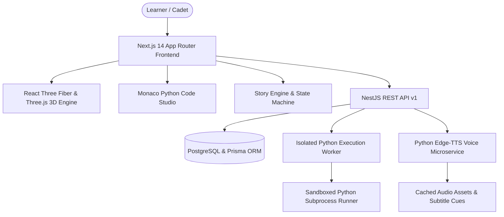

# CODEQUEST 2.0 — Cinematic 3D Interactive Programming Education Platform

> **"Write real code. Change the story."**

CODEQUEST is a cinematic story-driven programming education platform where learners enter rich 3D worlds, converse with characters, reason through problems before coding, write real Python programs, and witness their code dynamically alter the game environment.

---

## Architecture Overview



---

## Monorepo Layout

```
codequest/
  apps/
    web/                 # Next.js 14, React 18, Three.js, R3F, Monaco, Zustand, Tailwind
    api/                 # NestJS REST API (v1), Auth, Stories, Submissions, Voice, Curriculum
    voice-service/       # Python Edge-TTS service with SHA-256 audio disk caching & subtitles
    execution-worker/    # Isolated Python sandbox runner with timeouts & deterministic test cases
  packages/
    shared-types/        # Shared TypeScript domain models & DTOs
    story-schema/        # Zod validation & graph integrity checkers for narrative campaigns
    story-engine/        # Story state machine, choices, conditionals, and checkpoints
    learning-engine/     # Think Before You Code, progressive hints, and mastery evaluator
    game-engine/         # WebGL detector, camera choreography, and reactive visual states
    audio-engine/        # Multi-channel audio player, subtitle tracker, error fallbacks
    python-curriculum/   # 4 Stages, 12 modules, objectives, and code examples
    ui/                  # Shared Design System (Buttons, Cards, Badges, ThemeToggle)
    database/            # Prisma ORM schema & client
  content/
    python/
      last-protocol/     # Campaign 1: "The Last Protocol" (Orbital Station Aethelgard & ARIA)
      forgotten-kingdom/ # Campaign 2: OOP & Collections
      beyond-the-signal/ # Campaign 3: Files & Exceptions
      silent-witness/    # Campaign 4: Data Structures & Algorithms
  tests/                 # Automated validation tests
```

---

## Vertical Slice Walkthrough: "The Last Protocol"

1. **Awakening & Establishing Shot**:
   The player enters Orbital Station Aethelgard in high Earth orbit. The camera dollies smoothly across the 3D bridge deck bathed in pulsing crimson emergency lights.
2. **Meet ARIA**:
   ARIA, the station's AI guardian, appears with an articulated floating holographic chassis, animated gyroscopic rings, and an expressive soundwave visor.
3. **Voice Audio & Subtitles**:
   ARIA speaks her diagnostic lines using synthesized Edge-TTS (`en-US-AriaNeural`) with synchronized subtitles.
4. **Branching Decision**:
   The player chooses between routing preliminary diagnostics to the *Main Reactor Core* or the *Atmospheric Scrubber Matrix*, steering station variables and earning XP.
5. **Think Before You Code**:
   Before opening the code editor, the player must analyze standard output stream syntax and select the correct print syntax, reinforcing computational thinking.
6. **Monaco Python Code Studio**:
   Mission 1 ("Reboot Protocol Nexus") loads with problem context, starter code, test suites (visible & hidden), and 4 progressive hint levels.
7. **Isolated Execution & Environmental Reaction**:
   Running the program executes the code in the sandboxed Python worker. When all tests pass:
   - The station bridge lighting instantly transitions from emergency crimson to cyber cyan.
   - The massive rear reactor turbine spools up to high speed.
   - ARIA celebrates with a victory animation.
   - Player progress and +150 XP are persisted.

---

## Running the Application

### 1. Prerequisites
- Node.js >= 18 (Tested on Node.js v24)
- Python >= 3.10 with `edge-tts` and `fastapi` / `uvicorn`

### 2. Start the Voice Service
```bash
python -m uvicorn apps.voice-service.main:app --port 8001 --reload
```

### 3. Start the Execution Worker
```bash
python -m uvicorn apps.execution-worker.main:app --port 8002 --reload
```

### 4. Start the NestJS API
```bash
npm run dev:api
# Or: npx tsx apps/api/src/main.ts
```

### 5. Start the Web Frontend
```bash
npm run dev:web
# Available on http://localhost:3000
```
